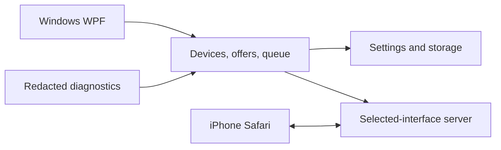

# LAN Drop product design

Updated: 2026-10-11. This document separates product targets from implemented features. See README for the current preview.

## Product promise

Start the Windows application, connect a phone through a QR code, approve it and transfer files over the local network. No mandatory account or cloud storage. Users must understand the recipient, destination folder and completion state.

Initial target: Windows 11 x64 and iPhone Safari. Additional devices become supported only after real-device verification. Internet connectivity must not be required for basic local file transfer.

## Advisory team

AI roles reviewed the proposal; this is not a staffed operations department or continuous monitoring.

| Role | Responsibility |
|---|---|
| Project manager | Scope, milestones, dependencies and release gates |
| Product manager | Useful features and a focused product boundary |
| User representative | First-run clarity without networking knowledge |
| UX/accessibility | Desktop/mobile flows, keyboard use, screen readers and touch |
| Security architect | Pairing, grants, threat model, storage and update trust |
| Network specialist | Interfaces, network profiles, firewall, VPN and guest isolation |
| Operations/support | Lifecycle, troubleshooting, cleanup and redacted diagnostics |
| C# architect | Modules, protocol, bounded streaming and state |
| QA/iOS tester | Automated regressions and physical-device test matrix |
| Release manager | Versions, portable/installer distribution, signatures |
| Localization | English/Czech parity, error codes and contribution workflow |

The project owner approves product direction. Release scope cannot waive security or quality gates.

## User flows

**Phone to PC:** select folder on PC → scan QR → approve phone → offer each file → accept on PC → stream and save → show completed files and Open folder. Current preview enforces per-file approval; checksum verification, resumable transfers and batch approval are future work.

**PC to phone:** add/drop files → select recipient → offer → phone downloads. Other phones must not see the offer. Distinguish available, server transfer complete and recipient confirmation. Safari-native download does not prove local file persistence.

**Text/links (later):** explicitly entered text, chosen recipient, manual Copy. No automatic clipboard monitoring.

## Screens and UX

Windows: Overview, Send, Transfers, Devices, History, Settings and Help/About. The preview combines these into one window. Phone: connection/approval followed by two clear actions, Send to PC and Files for me.

Settings target: folder, language, theme, PC name, preferred adapter, concurrency/storage limits, history retention and close behavior. Automatic startup and automatic sharing are separate opt-in choices.

Every state includes text, not color alone. QR has a copyable-link alternative; drag/drop has a file picker. Controls must support keyboard focus, readable contrast, zoom and screen readers. Announce meaningful transfer states, not every percentage. Respect reduced motion.

## Architecture

Target: .NET 10 + WPF desktop + ASP.NET Core transport + responsive Safari web client.

Future modules: Core, Transport, Desktop and Tests. Desktop ultimately calls Core directly. Current preview starts a child server and controls it through secret-authenticated loopback requests.

LAN clients never change local settings, browse arbitrary folders or execute files. If web administration remains, use a separate authenticated loopback listener. Basic entities: DeviceSession, PairingRequest, TransferOffer, TransferItem, RecipientGrant, Settings and HistoryEntry.

Transfer states: prepared, offered, accepted, transferring, verifying, completed; declined, paused, cancelled, interrupted, failed and expired. Resume uses transfer identity, validated position and content integrity. Changed source means a new transfer. Limit RAM, simultaneous streams, files and bytes.

## Security and privacy

Short-lived pairing with approval, recipient-specific grants, expiry and active-transfer revocation. A device name is a label, not proof of identity. Verification codes alone do not authenticate an HTTP-delivered page against an active attacker.

Validate Windows names, paths and reparse points. Preserve existing files. Complete via an atomic move; never automatically execute received content. Allow previews only for safe supported formats. Avoid direct HTML/SVG rendering of uploaded content.

Bound disk usage and metadata. Check available space before and during transfer. Clean up only verifiable app-owned abandoned temporary files. Never delete completed received files automatically.

Do not log QR secrets, sessions, file contents or full private paths. History retention is explicit and erasable. Diagnostics have a preview/redaction step and are never sent automatically. No telemetry in basic operation.

### Secure transport decision

The preview is HTTP on a trusted network. It is not end-to-end encrypted. Stable release requires an authenticated secure channel proven on physical iPhone hardware.

Safari-native HTTPS needs a trusted certificate, hostname/routing, secure per-installation key handling and certificate renewal. Do not distribute a shared private key. Installing a root profile expands phone trust and is not an invisible pairing step. Development certificates are not a distribution strategy.

Alternative: a separate native iOS client with an explicit trust/pinning design; this adds development and distribution scope. JavaScript encryption delivered through HTTP does not protect against modification of that script.

Choose and prototype the trust model before promising a stable delivery date. No browser-warning bypass or hidden cloud relay.

## Networking and operations

Bind to the selected IPv4 interface only, with loopback administration. Identify adapter name/type and profile. Avoid silently choosing a VPN. Windows Ethernet plus phone Wi-Fi on a reachable local network is valid.

Target default: block public-profile sharing; offer narrowly scoped private-profile firewall rules only with explicit system consent. Never disable firewall protections, bypass organization policy, use UPnP or expose router ports.

On IP change invalidate QR and explain disconnected transfers. Handle occupied ports without killing other services. Single app instance, deliberate shutdown, tray continuation and recovery from crashes.

Troubleshooting distinguishes no address, stopped server, occupied port, missing phone connection and failed transfer. Guest isolation/VPN/firewall are possible explanations, not facts without evidence.

## Localization and versions

English project documentation and default UI. Czech is a first-class option. PC and phone choose language independently; auto uses local preferences and unsupported languages fall back to English.

Stable translation keys, complete messages and named parameters; server returns machine-readable error codes. Locale-aware numbers/times and accessible translated labels. Installer and diagnostics must be translated before stable release.

SemVer for product: feature versions, patch fixes, explicit alpha/beta. A single version source feeds all binaries. Protocol and settings schema have separate versions with migration/compatibility handling.

Portable and installer, initially x64. Self-contained distribution avoids SDK requirements. Signed packages and verified updates are future release gates; never update during an active transfer.

## Roadmap and acceptance

See [ToDo.md](ToDo.md) for checked implementation progress. Original milestone numbering represents product gates, not a promise that all earlier gates are already met in an alpha build.

- Hardening: recipient isolation, explicit network binding, quotas and physical iPhone test.
- Desktop: folder picker, saved settings, tray, English/Czech, lifecycle.
- Reliability: queue/history, speed estimates, repeat/resume and checksums.
- Offers: per-transfer receive confirmation, text/links and safe previews.
- Distribution: installer/portable, redacted diagnostics and verified secure transport.
- Stable: supported platform matrix, secure updates and no critical unresolved defects.

## Verification gates

API tests: expiry/replay, two-device isolation, revoke midstream, illegal paths/names, duplicates, empty files, quotas, write failures, restart/migrations and resume/integrity.

Physical devices: 20 photos, HEIC/JPEG, videos, Unicode/emoji, multiple phones, Safari download/save, background/lock behavior, network loss and sleep. Test Wi-Fi/Ethernet, VPN, guest isolation, public/private profile, managed firewall, address changes and occupied ports.

Measure memory/CPU/disk and throughput on a defined reference network. A configured 10 GB maximum is not a performance guarantee. Install/upgrade/uninstall without losing completed user files. Loopback CI cannot replace physical iPhone/network tests.

Defer cloud accounts/relay, automatic folder/clipboard synchronization, system service, enterprise management and whole-disk sharing.

## Technical references

- [WPF](https://learn.microsoft.com/en-us/dotnet/desktop/wpf/overview/)
- [Apple local network privacy](https://developer.apple.com/documentation/technotes/tn3179-understanding-local-network-privacy)
- [Apple certificate trust](https://support.apple.com/en-us/102390)
- [Windows firewall rules](https://learn.microsoft.com/en-us/windows/security/operating-system-security/network-security/windows-firewall/rules)
