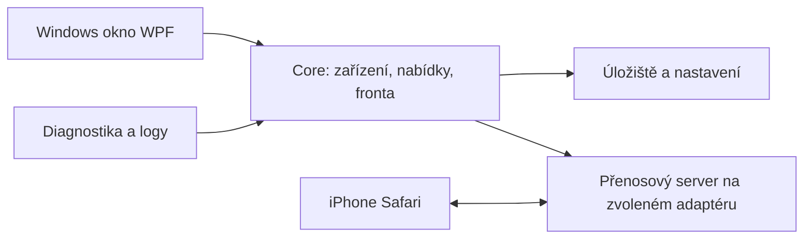

# LAN Drop — návrh aplikace a tým

Datum: 11. října 2026. Stav: návrh pro další vývoj, nikoliv seznam hotových funkcí.

## 1. Produkt

LAN Drop je malá Windows aplikace pro přenos souborů a krátkého textu mezi počítačem a telefonem v místní síti. iPhone se připojuje přes QR v Safari bez povinného účtu či vlastní iOS aplikace. Základní přenos nesmí záviset na dostupnosti internetu ani posílat soubory do externího úložiště.

Hlavní slib: spustím aplikaci, připojím telefon, potvrdím ho a přenesu soubory. Uživatel vždy vidí, komu co posílá, kam se soubor uloží a jestli přenos skutečně skončil.

První podporovaná cílová platforma je Windows 11 x64 + iPhone Safari. Další platformy až podle fyzických testů; přístup přes Android nebo další počítač je možný směr, ne deklarovaná podpora.

## 2. Tým a odpovědnosti

Jde o poradní role AI týmu pro tento návrh. Produkt/uživatel/UX, bezpečnost a síť/provoz/QA byly posouzeny třemi samostatnými agenty; architektura a výsledná syntéza hlavním agentem. Není to skutečné provozní oddělení ani nepřetržitý monitoring.

| Role | Odpovídá za | Co musí před vydáním ověřit |
|---|---|---|
| Projektový manažer | Rozsah verze, návaznosti, backlog, hotové vs plánované | Vydání plní své podmínky a nemá nedořešené zásadní blokátory |
| Produktový manažer | Smysl funkcí a hranice produktu | Základní cesta je jednodušší než alternativní ruční postup |
| Zástupce uživatele | Srozumitelnost pro člověka bez síťových znalostí | Nový uživatel přenese fotky podle instrukcí v aplikaci |
| UX a přístupnost | Obrazovky, mobilní ovládání, klávesnice, čtečky | Stav není vyjádřen jen barvou, formuláře mají popisky, vše zásadní je ovladatelné klávesnicí |
| Bezpečnostní architekt | Párování, přístup k souborům, hrozby, aktualizace | Zařízení nemůže číst cizí nabídky ani ovládat počítač |
| Síťový specialista | Adaptéry, profily sítí, firewall, VPN, izolace klientů | Server neposlouchá nechtěně na ostatních adaptérech |
| Provoz a podpora | Spuštění/vypnutí, logy, diagnostika, úklid | Výpadek má vysvětlení a opravitelný postup |
| C# architekt/vývojář | Modulární řešení, datový model, výkon | Přenos nezávisí na otevřeném hlavním okně a nebufferuje celé soubory |
| QA a tester iOS | Testovací scénáře a reálné přístroje | Výsledky odpovídají konkrétním verzím Windows a iOS |
| Správce vydání | Verze, instalátor, podpis, distribuce | Balíček jde instalovat, aktualizovat a odinstalovat |
| Lokalizace | České/anglické texty, plurály a formáty | Žádná zásadní hláška ani instalátor nezůstává nepřeložený |

Manažer řídí rozsah, ale neobchází podmínky bezpečnosti a kvality. Zásadní změny produktu a vydání schvaluje majitel projektu.

## 3. Co již existuje

Verze 0.1.0 obsahuje C# HTTP server, české webové rozhraní, místně generovaný QR, schválení/odpojení zařízení, postupné obousměrné nahrávání, průběh/storno, změnu příjmové složky a ochranu před přepsáním. Automatické HTTP testy ověřují přenosy a základní přístupová omezení.

Zatím chybí nativní okno, trvalé nastavení, izolace souborů mezi příjemci, obnovení nahrávání, bezpečný distribuční/aktualizační proces a ověření na skutečném iPhonu. HTTP nešifruje obsah ani autentizační tokeny; schválení telefonu tuto vlastnost nenahrazuje. Server nyní naslouchá na všech IPv4 adaptérech.

## 4. Hlavní uživatelské cesty

### Telefon → PC

1. Na PC zapnout sdílení na konkrétní síti a zvolit příjmovou složku.
2. Na telefonu načíst QR, zadat název a požádat o připojení.
3. Na PC ověřit požadavek a potvrdit zařízení.
4. Telefon vybere soubory; PC vidí nabídku, počet a celkovou velikost.
5. PC nabídku schválí. Volba automatického příjmu platí jen pro konkrétní zařízení a aktuální relaci.
6. Telefon i PC vidí průběh. PC oznámí dokončení až po zápisu, kontrole a přesunu do cílové složky.
7. PC nabídne Otevřít složku. Soubor se automaticky nespouští.

### PC → telefon

1. Přetáhnout soubory nebo zvolit Přidat soubory.
2. Vybrat připojený telefon. Jiná zařízení nabídku neuvidí.
3. Telefon vidí názvy/velikosti a zvolí Stáhnout.
4. Nativní stažení spravuje Safari; aplikace přesně rozlišuje nabídnuto, přeneseno ze serveru a potvrzeno příjemcem.
5. Bez potvrzení telefonu neslibovat, že soubor byl uložen na disk telefonu či do Fotek.

### Text a odkazy

Samostatná karta pro ručně vložený text nebo URL a tlačítko Kopírovat u příjemce. Žádné automatické sledování systémové schránky. Připojení/příjemce i bezpečnostní pravidla jsou stejné jako pro soubory. Zařadit až po stabilizaci základního přenosu.

## 5. Obrazovky

| Windows | Obsah |
|---|---|
| Přehled | Stav sdílení, aktivní síť, QR, příjmová složka, čekající požadavky |
| Odeslat | Výběr souborů, příjemce, součet velikostí, nabídka |
| Přenosy | Fronta, rychlost, odhad času, průběh, storno/opakovat |
| Zařízení | Aktuální relace, potvrzení, odpojení, oprávnění příjmu |
| Historie | Směr, čas, zařízení, výsledek, Otevřít složku |
| Nastavení | Jazyk, motiv, složka, síť, limity, chování při zavření |
| Pomoc / O aplikaci | Diagnostika, verze, změny, licence, odkazy |

Telefon: Připojení → čekání na schválení → dvě hlavní akce Odeslat do PC a Soubory pro mě. Pokročilé síťové nastavení patří na PC.

Vzhled navazuje na současný tmavý design se zeleným akcentem; doplnit světlý a systémový motiv. Při aktivním přenosu nesmí zavření hlavního okna nečekaně ukončit službu: nabídnout pokračování v oznamovací oblasti nebo ukončení. Spuštění po přihlášení i automatické zapnutí sdílení jsou samostatné, výchozí vypnuté volby.

Přístupnost: viditelný focus, velké dotykové cíle, popisky čteček a smysluplné pořadí klávesnice. QR doplnit ruční adresou a Kopírovat odkaz; přetažení doplnit výběrem souborů. Zvětšení textu nesmí skrýt ovládání. Respektovat omezení animací; čtečka oznamuje změnu stavu, nikoli každý procentní bod.

## 6. Doporučená architektura

Doporučení: .NET 10, nativní WPF klient pro Windows, stávající ASP.NET Core jako přenosová služba a responzivní web pro Safari. Sdílet doménovou logiku, nikoliv podmínit mobilní stránku desktopovým UI. WPF dává přímý přístup k dialogům a Windows integraci; případný WebView2 obal je alternativa, která vyžaduje vlastní posouzení závislostí a zabezpečení mostu do systému.

Navržené projekty: LanDrop.Core, LanDrop.Transport, LanDrop.Desktop a LanDrop.Tests. Mobilní web zůstává součástí Transport. Desktop volá Core přímo; síťové API nezpřístupňuje změnu lokálních cest, otevření souborů ani systémovou správu. Pokud zůstane pomocná webová administrace, musí mít samostatný loopback listener a samostatnou autentizaci.

Základní entity: DeviceSession, PairingRequest, TransferOffer, TransferItem, RecipientGrant, Settings a HistoryEntry. Každá nabídka má příjemce, expiraci a oprávnění pro konkrétní soubory. Protokol má vlastní major verzi nezávislou na čísle aplikace.

Stavy přenosu: připraveno → nabídnuto → přijato → přenáší se → ověřuje se → dokončeno. Vedlejší stavy: odmítnuto, pozastaveno, zrušeno, přerušeno, chyba, vypršelo. Některé stavy a kontrolní součty jsou dostupné pouze v řízeném přenosu; běžné Safari stažení nesmí předstírat potvrzení místního uložení.

Nahrávání má malé bloky, omezený počet souběžných přenosů a kvóty; velký soubor se nedrží celý v paměti. Obnova používá ID přenosu, ověřenou pozici a kontrolní součet; změněný zdroj znamená nový přenos. Cílový soubor je viditelný jako hotový až po atomickém dokončení. Metadata fronty a historie se ukládají odděleně od obsahu.

## 7. Bezpečnostní návrh

- Párovací odkaz je krátkodobý a spotřebuje se při schválení. Opakovaný požadavek nesmí tiše vytvářet další důvěryhodné relace.
- Potvrzení náhodné krátké fráze/čísla na obou displejích pomáhá spojit požadavek se zařízením. Samo o sobě neřeší aktivního útočníka na HTTP; důvěra musí být součástí celého návrhu transportu.
- Přístup pouze k výslovně nabídnutým souborům pro daného příjemce. Žádný seznam disku ani sdílení celé složky v základu.
- Odpojení zneplatní oprávnění a ukončí aktivní přenosy daného zařízení.
- Limit požadavků, zařízení, fronty, souběžných streamů a objemu dat. Kontrola místa i během zápisu.
- Cesty a názvy validovat pro Windows včetně rezervovaných názvů a oddělit je od náhodných ID úložiště. Nepřepisovat existující soubory.
- Příjem nemůže zapisovat mimo zvolenou složku. Ošetřit odkazy/reparse points, souběh změny složky a dokončení přenosu.
- Nedůvěryhodný obsah nepoužívat jako HTML a automaticky neotevírat. Náhledy povolit jen pro vybrané formáty; aktivní obsah HTML/SVG nezobrazovat přímo.
- Klíče, cookies, QR tokeny, obsah souborů a plné cesty nepatří do běžných logů. Historie má omezenou dobu uchování a tlačítko Vymazat.
- Základní provoz bez telemetrie. Kontrola aktualizací komunikuje ven pouze výslovně uvedeným způsobem.

### Rozhodnutí o šifrování — blokátor veřejného vydání

Safari bez instalace iOS aplikace a bez důvěryhodného certifikátu pro lokální adresu není automaticky bezpečný HTTPS produkt. Nedoporučovat obcházení varování Safari ani instalaci nedůvěryhodných profilů.

| Varianta | Výhoda | Náklad / hranice |
|---|---|---|
| HTTP na důvěryhodné LAN | Nejjednodušší offline prototyp | Obsah/tokeny lze odposlouchávat a provoz měnit; nesmí být vydáván za bezpečné sdílení |
| Důvěryhodné HTTPS pro Safari | Běžná webová cesta | Je nutné navrhnout doménu, vydávání a obnovu certifikátů, DNS a ochranu soukromých klíčů; žádný společný privátní klíč v distribuované appce |
| Vlastní iOS klient | Umožňuje navrhnout explicitní důvěru a pinning | Samostatný projekt, distribuce iOS a nové testy; nelze ztotožnit s webovým MVP |

Před veřejnou beta vytvořit ověřovací prototyp zvolené varianty na fyzickém iPhonu a napsat konkrétní model důvěry. Odhad rozsahu 1.0 je do té doby podmíněný. Žádný cloudový relay bez změny produktového zadání.

Alternativa s ručně instalovaným certifikačním profilem je pouze pro technické či řízené prostředí. Instalace profilu sama automaticky nezískává SSL důvěru; kořenový certifikát navíc rozšiřuje systémovou důvěru telefonu. Nelze ji ukrýt do běžného párování. JavaScriptové šifrování doručené přes HTTP neřeší aktivního útočníka, který může změnit samotnou stránku.

## 8. Síť a provoz

- Naslouchat pouze na uživatelem potvrzené IPv4 adrese. Ukázat název adaptéru, typ připojení a profil sítě.
- Upřednostnit běžné Wi-Fi/Ethernet adaptéry, VPN a virtuální sítě nezvolit tiše. „Stejná Wi-Fi“ sama negarantuje dosažitelnost.
- Sdílení na veřejném profilu výchozí blokovat; doplnit vysvětlení.
- Firewall pravidlo případně nabídnout pro konkrétní aplikaci/port, privátní profil a místní podsíť. Potřebné oprávnění vyžádat až pro konkrétní změnu; aplikace běžně neběží jako administrátor.
- Nikdy automaticky nevypínat firewall, nepřidávat UPnP mapování a neotevírat router do internetu.
- Změna IP či sítě zneplatní QR; existující přenos má srozumitelný stav a možnost pokračování, když to protokol umožňuje.
- Při kolizi portu nabídnout jiný a přegenerovat QR; nevypínat jinou službu.
- Jedna instance aplikace, kontrolované zastavení a úklid vlastních dočasných souborů po pádu. Úklid se nesmí dotknout dokončeného příjmu.
- Diagnostika rozlišuje „server neběží“, „není síťová adresa“, „port je obsazen“, „zařízení se nepřipojilo“ a „přenos selhal“. Firewall, guest isolation a VPN mohou být možné příčiny; bez důkazu je neoznačovat za jistou příčinu.
- Kopírovatelný diagnostický přehled má náhled a redakci citlivých údajů; neposílat automaticky.

## 9. Jazyky, nastavení a verze

Čeština a angličtina od prvního desktopového vydání. Jazyk podle systému/prohlížeče, možnost ručního přepnutí, anglický fallback. Jazyk počítače a telefonu může být různý. Texty mají stabilní klíče, bez skládání vět z útržků; podporují plurály, formáty čísel, datumů a velikostí. Přeložit i instalátor, diagnostiku a hlášky serveru. Server vrací kód chyby a parametry, klient jej lokalizuje.

Nastavení: příjmová složka, jazyk, motiv, jméno PC, preferovaný adaptér, limity, uchování historie a chování při zavření. Uložit atomicky s verzí schématu a migracemi. Trvalé důvěryhodné zařízení je samostatná budoucí funkce; výchozí relace expirují.

SemVer: nové funkce 0.2.0, opravy 0.2.1, testovací vydání 0.3.0-beta.1. Verze pochází z jednoho zdroje pro binární soubor, O aplikaci a release. Přidat CHANGELOG.md, Git tagy a GitHub Releases. Číslo protokolu a schématu nastavení vést zvlášť.

Balíčky: portable a instalátor, nejprve Windows x64. ARM64 až po ověření. Self-contained distribuce odstraní potřebu uživatelské instalace SDK. Podepisování instalátoru/appky plánovat jako náklad; samotný GitHub release neznamená důvěryhodnost. Aktualizaci stahovat přes ověřené HTTPS a ověřovat podpis; základní přenos funguje i bez kontroly aktualizací.

## 10. Roadmapa a podmínky dokončení

| Verze | Výsledek | Podmínka dokončení |
|---|---|---|
| 0.1.1 | Hardening prototypu: izolace příjemců, kvóty, přesný adaptér, úklid | Neoprávněný/odpojený telefon nečte cizí nabídky; reálný test 20 fotek a jednoho videa |
| 0.2.0 | Nativní Windows okno, složkový dialog, persistentní nastavení, cs/en | Použití bez terminálu; přenos pokračuje při minimalizaci; čistý start/restart |
| 0.3.0 | Fronta, historie, rychlost, opakování, kontrolní součty, obnova uploadu | Výpadek nezničí původní soubory; změněný zdroj se neobnoví chybně |
| 0.4.0 | Nabídky/potvrzení, text, volitelně bezpečné náhledy | Uživatelské cesty a oprávnění pokryty testy; rozhodnutý a ověřený bezpečný transport |
| 0.5.0-beta | Instalátor/portable, diagnostika a ověřená bezpečná varianta | Fyzická iOS matice, síťové scénáře a kontrola distribuce |
| 1.0.0 | Stabilní vydání s doloženými podporovanými platformami | Bez otevřených kritických chyb, splněné bezpečnostní a kvalitativní podmínky |

Bezpečnost a iPhone testování probíhají průběžně, nikoli až v poslední verzi. Pokud bezpečný transport vyžaduje vlastní iOS klient, upravit rozsah a roadmapu před dalším slibováním termínu.

Zatím odložit: veřejné internetové sdílení, uživatelské účty, automatickou synchronizaci složek/schránky, systémovou službu, centrální firemní správu a sdílení celého disku.

## 11. Testování a vydání

Automaticky: párování/expirace/replay, oddělení příjemců, odpojení během přenosu, CSRF/host validation, nepovolené cesty a rezervované názvy, duplicity, prázdné soubory, kvóty, výpadky zápisu, restart/migrace, zbytek po pádu, blokové obnovení a integrita.

Dosavadní integrační testy používají loopback; nedokazují funkčnost fyzického telefonu, firewallu ani komunikaci přes Wi-Fi.

Na fyzických zařízeních: 20 fotek (HEIC/JPEG podle zdroje), různě velká videa, názvy s diakritikou/emoji, více telefonů, Safari stažení a ukládání, zamknutí/přepnutí aplikace, ztráta Wi-Fi, Windows uspání, ztráta místa a práva cílové složky.

Síťová matice: PC Wi-Fi i Ethernet, více adaptérů, VPN, veřejný/privátní profil, guest Wi-Fi/client isolation, spravovaný firewall, změna IP, obsazený port. Přesné podporované verze Windows/iOS zapsat až na základě výsledků.

Měřit RAM/CPU, rychlost a spotřebu dočasného místa, včetně velkého souboru u stanoveného limitu; nynější 10 GB je konfigurační limit, nikoli ověřený výkonový slib. Ověřit instalaci, upgrade, portable režim, odinstalaci a uchování dokončených příjmů. Nedostupný internet nesmí rozbít lokální režim.

## 12. Pořadí nejbližší práce

1. Uzavřít fyzický test 0.1.0 na iPhonu a zaznamenat omezení.
2. Dodat minimální izolaci příjemců, síťový binding, kvóty a testy pro 0.1.1.
3. Udělat krátké ověření bezpečného transportu; vybrat variantu a vyhodnotit závislosti.
4. Připravit Core/Transport/Desktop a společné chybové/lokalizační klíče.
5. Implementovat 0.2.0 a ověřit celou cestu bez vývojářských nástrojů.

## Zdroje k technickým hranicím

- [Microsoft: WPF](https://learn.microsoft.com/en-us/dotnet/desktop/wpf/overview/) — nativní Windows UI, doporučení platformy je návrhové rozhodnutí.
- [Apple TN3179](https://developer.apple.com/documentation/technotes/tn3179-understanding-local-network-privacy) — chování lokální síťové privacy; Safari není totéž co vlastní iOS síťový klient.
- [Microsoft: WebView2 distribuce](https://learn.microsoft.com/en-us/microsoft-edge/webview2/concepts/distribution) — závislosti alternativního desktopového obalu.
- [Apple: ručně instalované certifikáty](https://support.apple.com/en-us/102390) — samostatné nastavení důvěry SSL na iPhonu.
- [Microsoft: pravidla Windows Firewall](https://learn.microsoft.com/en-us/windows/security/operating-system-security/network-security/windows-firewall/rules) — profily, místní rozsahy a omezení spravovaného zařízení.
